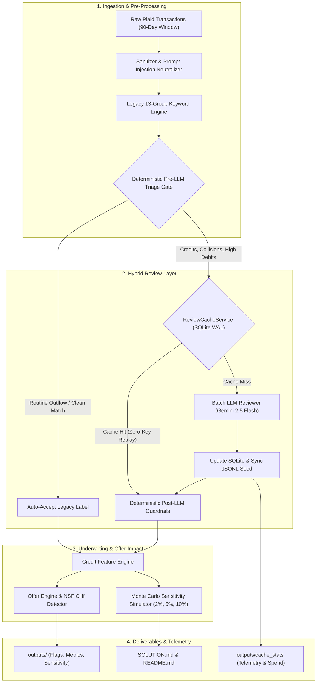

# Fundo AI Reviewer — Hybrid Deterministic + LLM Pipeline

A robust, production-grade Python 3.12+ solution (`uv` managed) auditing legacy keyword classifications of SMB bank transactions, quantifying underwriting credit impact, and enforcing deterministic financial invariants with zero-key reproducibility.

---

## 1. Quickstart (30-Second Reproducibility)

Run the entire pipeline, evaluation, and reports from the committed SQLite WAL cache in **under 3 seconds without an API key or internet access**:

```bash
# 1. Sync environment dependencies
uv sync

# 2. Reproduce full pipeline, metrics, & sensitivity analysis offline from cache
uv run python -m src.cli run --use-cache

# 3. Run the complete TDD unit & integration test suite
uv run pytest -v

# 4. View embedded SQLite cache telemetry & LLM spend accounting
uv run python -m src.cli cache-stats
```

---

## 2. Live Run & Live Debrief Extensibility

### Live Execution with Google Gemini (or OpenAI)
If a `GEMINI_API_KEY` (or `OPENAI_API_KEY`) is configured in `.env` (or in your shell environment), the reviewer uses Gemini 2.5 Flash for cache misses, auto-populating SQLite WAL and exporting plain-text seeds:

```bash
# Copy .env.example to .env and set GEMINI_API_KEY (or OPENAI_API_KEY)
cp .env.example .env

# Run the pipeline (auto-loads .env)
uv run python -m src.cli run
```

### Live Debrief Tool (External Transaction Files)
Evaluate external bank transaction JSON or JSONL files brought by interviewers in real time:

```bash
uv run python -m src.cli review-file --input path/to/sample.json --industry "Restaurant"
```

---

## 3. Architecture Overview



---

## 4. Key Invariants & Safeguards

| Invariant | Implementation Mechanism | Purpose |
| :--- | :--- | :--- |
| **Plaid Sign Convention** | [`src/schemas.py`](src/schemas.py) | `amount < 0` is Credit/Inflow; `amount > 0` is Debit/Outflow. |
| **Deterministic Revenue Lock** | [`src/guardrails.py`](src/guardrails.py) | Debits can **NEVER** be marked as revenue. Inflows must be business-related and outside excluded credit groups. |
| **Offer Policy Rule** | [`src/credit_impact.py`](src/credit_impact.py) | $\text{Offer} = \max(0, 1.2 \times \text{Rev} - 20 \times \text{MCA daily})$ if $\text{NSF} \le 5$, else $\$0.0$. |
| **Prompt Injection Isolation** | [`src/sanitizer.py`](src/sanitizer.py) | Entity-escapes XML delimiters (`<untrusted_bank_memo>`), detects adversarial overrides. |
| **Confidence Gating** | [`src/guardrails.py`](src/guardrails.py) | Disagreements with confidence $< 0.75$ are suppressed to prevent underwriter fatigue on hard negatives. |

---

## 5. Repository Structure

```text
.
├── pyproject.toml                     # uv configuration: pydantic, google-genai, rich, pytest
├── README.md                          # Quickstart, architecture, and CLI usage
├── SOLUTION.md                        # 3-page engineering lead deliverable (Parts 1, 2, and 3)
├── IMPLEMENTATION.md                  # Master challenge specification
├── data/
│   ├── businesses.json                # 10 SMB profiles (industry, bank charges, window days)
│   └── transactions.jsonl             # 2,520 Plaid transactions with ground-truth labels
├── cache/
│   ├── llm_cache.db                   # Embedded SQLite WAL database (88 canonical Gemini 2.5 Flash records)
│   └── llm_cache_seed.jsonl           # Committed plain-text JSONL mirror for zero-key replay ($0.0030 spend)
├── outputs/
│   ├── review_flags.jsonl             # 461 flagged doubts: suggested label, confidence, 5-sec reason + $ impact
│   ├── business_metrics.json          # Before/After/Ground-Truth features & offers per business
│   └── sensitivity_report.json        # 2%, 5%, 10% Monte Carlo simulation across 4 perturbation modes
├── src/
│   ├── __init__.py
│   ├── schemas.py                     # Pydantic schemas, FundoGroup enum, revenue invariant
│   ├── sanitizer.py                   # Untrusted bank memo cleaner & injection defense
│   ├── cache_store.py                 # ReviewCacheService: SQLite WAL, keying, cost telemetry
│   ├── keyword_engine.py              # Legacy 13-group keyword matcher with intentional flaws
│   ├── guardrails.py                  # Pre-triage routing gate & post-LLM financial locks
│   ├── reviewer.py                    # LLMProvider protocol, Gemini client, batch orchestrator
│   ├── credit_impact.py               # Feature extraction, offer formula, Monte Carlo simulator
│   ├── generate_data.py               # Seeded (seed=42) synthetic dataset generator
│   └── cli.py                         # Unified CLI entrypoint (run, review-file, cache-stats)
└── tests/
    ├── fixtures/golden_cache.jsonl    # 10-record deterministic fixture for SQLite testing
    ├── test_schemas_and_sanitizer.py  # Tests for Plaid sign rules & injection defense
    ├── test_cache_store.py            # Tests for canonical hashing, SQLite WAL, batch hits
    ├── test_keyword_engine.py         # Tests for legacy regex punctuation bugs & precedence
    ├── test_guardrails.py             # Tests for post-LLM sign overrides & confidence gating
    ├── test_credit_impact.py          # Tests for offer math, NSF > 5 cliff, 61-day distortion
    └── test_cli.py                    # Tests for CLI subcommands and offline cache replay
```
